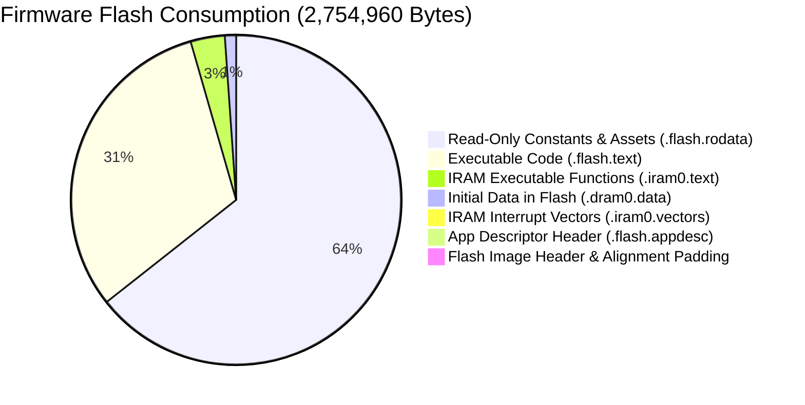

# IoT_Micro — Complete Flash Memory Map & Storage Audit

## 1. Physical Flash Partition Layout

The target handheld hardware is an **ESP32-D0WD-V3** (Revision 3.1) equipped with a **4 MB (32 Mbit, 4,194,304 bytes)** external SPI flash chip connected via high-speed Dual I/O (DIO) at 40 MHz.

The partition layout is defined by `huge_app.csv` (from the PlatformIO Arduino-ESP32 framework). The complete 4,194,304-byte flash boundary is fully mapped as follows:

| Region / Partition | Subtype | Start Offset | End Offset | Total Capacity | Measured Used | Remaining Space | % Used | Purpose & Lifecycle |
|---|---|---|---|---:|---:|---:|---:|---|
| **Primary Bootloader Table** | `reserved` | `0x000000` | `0x001000` | 4,096 B (4 KB) | 4,096 B | 0 B | 100.0% | ROM bootloader vectors & flash configuration header |
| **2nd Stage Bootloader** | `bootloader` | `0x001000` | `0x009000` | 32,768 B (32 KB) | 17,536 B | 15,232 B | 53.5% | ESP-IDF 2nd-stage bootloader (`bootloader.bin`) |
| **NVS (Non-Volatile Storage)** | `nvs` | `0x009000` | `0x00E000` | 20,480 B (20 KB) | ~4,096 B | ~16,384 B | ~20.0% | Wi-Fi credentials, RF calibration data, system settings |
| **OTA Data** | `ota` | `0x00E000` | `0x010000` | 8,192 B (8 KB) | 0 B | 8,192 B | 0.0% | OTA sequence sector (unused, inactive partition scheme) |
| **Application 0 (`app0`)** | `ota_0` | `0x010000` | `0x310000` | 3,145,728 B (3,072 KB) | 2,754,960 B | 390,768 B | **87.6%** | Primary firmware executable image (`firmware.bin`) |
| **Filesystem (`spiffs`)** | `spiffs` | `0x310000` | `0x3F0000` | 917,504 B (896 KB) | ~48,000 B | ~869,504 B | **5.2%** | Onboard LittleFS partition: `/pokemon_red.sav` (32 KB) + metadata |
| **Core Dump (`coredump`)** | `coredump` | `0x3F0000` | `0x400000` | 65,536 B (64 KB) | 0 B | 65,536 B | 0.0% | ESP-IDF post-mortem crash dump sector |
| **Total Physical Flash** | **All** | `0x000000` | `0x400000` | **4,194,304 B (4.0 MB)** | **2,828,792 B** | **1,365,512 B** | **67.4%** | Physical 32 Mbit SPI Flash |

> [!NOTE]
> **Partition Safety & Headroom**:
> - The primary application partition (`app0`) currently has **390,768 bytes (~381.6 KB, 12.4%)** of free flash space remaining before hitting the partition boundary.
> - The filesystem partition (`spiffs`) is formatted as **LittleFS** (896 KB). It contains the active persistent cartridge RAM file `/pokemon_red.sav` (32,768 bytes), leaving **~868 KB of free storage**.

---

## 2. Firmware Binary Flash Composition

The compiled `firmware.bin` occupies **2,754,960 bytes** on disk and in flash. The image is constructed by `esptool.py` from the linker segments in `.pio/build/esp32dev/firmware.elf`:

### Exact Section Breakdown

| ELF Linker Section | Memory Map Type | Target Address Range | Section Size in Binary | Description |
|---|---|---|---:|---|
| **`.flash.rodata`** | MMU-mapped Flash Cache | `0x3F400120` – `0x3F5AFCB8` | **1,768,348 B (1,726.9 KB)** | Embedded ROMs, pixel art, fonts, string literals, lookup tables |
| **`.flash.text`** | MMU-mapped Flash I-Cache | `0x400D0020` – `0x401A12AB` | **856,747 B (836.7 KB)** | All application logic, game loops, emulator CPU/PPU engines, networking |
| **`.iram0.text`** | Loaded into Fast IRAM | `0x40080400` – `0x40096B4B` | **92,027 B (89.9 KB)** | Time-critical NES CPU clock loop, FreeRTOS kernel, SPI flash HAL |
| **`.iram0.vectors`** | Loaded into Fast IRAM | `0x40080000` – `0x40080403` | **1,027 B (1.0 KB)** | Xtensa Windowed ABI & Level 1-7 interrupt vectors |
| **`.dram0.data`** | Initialized Data (Flash $\to$ DRAM) | `0x3FFB0000` – `0x3FFB7620` | **30,240 B (29.5 KB)** | Pre-initialized global/static variables copied to DRAM on boot |
| **`.flash.appdesc`** | MMU-mapped Flash | `0x3F400020` – `0x3F400120` | **256 B (0.2 KB)** | ESP-IDF firmware descriptor (project version, IDF version, hash) |
| **Header & Padding** | Flash Boot Header | Start of sectors | **6,315 B (6.2 KB)** | 24-byte image header, segment headers, and flash page alignment padding |
| **Total `firmware.bin`** | — | — | **2,754,960 B (2.63 MB)** | Flash footprint written to `0x010000` |

---

## 3. Flash Consumption by Module / Subsystem

Using GNU ld map parsing (`firmware.map`), every single symbol and section has been attributed to its parent module:

| Rank | Subsystem / Module | Flash Code (`.text`) | Flash Data (`.rodata`) | Total Linked Flash | % of Flash | Primary Content |
|:---:|---|---:|---:|---:|---:|---|
| **1** | **Retro Arcade (NES)** | 10,066 B | 538,311 B | **548,377 B** | 21.1% | Mario ROM (393 KB), Contra ROM (139 KB), NES CPU/PPU engines |
| **2** | **Lost Crown Game** | 8,566 B | 487,462 B | **496,028 B** | 19.1% | Level 1 background (240 KB), Title art, Veera animations |
| **3** | **Retro Arcade (Game Boy)** | 23,955 B | 467,009 B | **490,964 B** | 18.9% | Pokémon Red LZ4 ROM (456 KB), Gnuboy CPU/PPU, LittleFS Save |
| **4** | **Wi-Fi & Networking Stack** | 312,551 B | 48,713 B | **361,264 B** | 13.9% | Net80211 (128 KB), LwIP (101 KB), WPA Supplicant (41 KB) |
| **5** | **C/C++ Standard Runtime** | 203,744 B | 55,646 B | **259,390 B** | 10.0% | Newlib LibC (`vfprintf`, math), LibM, LibGCC, LibStdC++ |
| **6** | **ESP-IDF System & Drivers** | 162,138 B | 47,961 B | **210,099 B** | 8.1% | mbedTLS (101 KB), Driver HAL, LittleFS driver (27 KB), NVS |
| **7** | **Retro Arcade (Common / UI)** | 3,165 B | 68,128 B | **71,293 B** | 2.7% | Game selector UI, 3x thumbnail graphics (67 KB) |
| **8** | **System / OS Core & UI** | 11,389 B | 23,431 B | **34,820 B** | 1.3% | Home screen, app launcher grid, 7x icons (14 KB), Quote system |
| **9** | **Arduino Core (ESP32)** | 20,014 B | 8,782 B | **28,796 B** | 1.1% | HardwareSerial, SPI, Print, WString, Stream |
| **10** | **Pixel Wars Game** | 20,653 B | 4,531 B | **25,184 B** | 1.0% | Game loop, particle system, wave generator, player/enemy logic |
| **11** | **Spotify Remote App** | 15,220 B | 3,571 B | **18,791 B** | 0.7% | HTTP client, WebSockets UI, playback controls |
| **12** | **Adafruit GFX / ST7735** | 8,453 B | 4,177 B | **12,630 B** | 0.5% | Display driver primitives, ST7735 command tables |
| **13** | **Hackk Security Suite** | 6,417 B | 2,198 B | **8,615 B** | 0.3% | Deauth engine, Evil Twin AP, packet sniffer, raw frame injector |
| **14** | **AI Assistant App** | 6,718 B | 1,285 B | **8,003 B** | 0.3% | HTTP REST client, virtual keyboard UI, dialogue renderer |
| **15** | **FreeRTOS Kernel** | 613 B | 3,290 B | **3,903 B** | 0.2% | Task scheduler, semaphores, queues |
| **—** | **Other IDF Libraries** | 13,356 B | 7,788 B | **21,144 B** | 0.8% | Diagnostics, RingBuffer, Event loops |
| **Total** | **All Firmware Modules** | **827,018 B** | **1,772,283 B** | **2,599,301 B** | **100.0%** | Excludes 122 KB IRAM & initial DRAM data |

---

## 4. Top 30 Largest Linked Object Files by Flash Footprint

| Rank | Object File | Owning Module | Code Size | Rodata Size | Total Flash | % of Bin |
|:---:|---|---|---:|---:|---:|---:|
| **1** | `src/retro/gb/GbRomData.S.o` | Retro Arcade (GB) | 0 B | 455,864 B | **455,864 B** | 16.5% |
| **2** | `src/retro/nes/roms/RomMario.S.o` | Retro Arcade (NES) | 0 B | 393,236 B | **393,236 B** | 14.3% |
| **3** | `src/lost_crown/Level1.cpp.o` | Lost Crown Game | 3,136 B | 304,560 B | **307,696 B** | 11.2% |
| **4** | `src/retro/nes/roms/RomContra.S.o` | Retro Arcade (NES) | 0 B | 139,284 B | **139,284 B** | 5.1% |
| **5** | `src/lost_crown/LostCrownGameplay.cpp.o` | Lost Crown Game | 3,701 B | 99,520 B | **103,221 B** | 3.7% |
| **6** | `src/retro/RetroLauncher.cpp.o` | Retro Launcher | 763 B | 67,117 B | **67,880 B** | 2.5% |
| **7** | `src/lost_crown/LostCrownLoading.cpp.o` | Lost Crown Game | 1,134 B | 42,155 B | **43,289 B** | 1.6% |
| **8** | `src/lost_crown/LostCrownTitle.cpp.o` | Lost Crown Game | 595 B | 41,227 B | **41,822 B** | 1.5% |
| **9** | `src/home_screen.cpp.o` | OS Core / UI | 3,337 B | 19,758 B | **23,095 B** | 0.8% |
| **10** | `libesp_littlefs.a(lfs.c.obj)` | ESP-IDF LittleFS | 15,684 B | 2,332 B | **18,016 B** | 0.7% |
| **11** | `libnet80211.a(wl_cnx.o)` | Wi-Fi Stack | 13,780 B | 3,932 B | **17,712 B** | 0.6% |
| **12** | `libnet80211.a(ieee80211_sta.o)` | Wi-Fi Stack | 12,613 B | 3,013 B | **15,626 B** | 0.6% |
| **13** | `libmbedcrypto.a(error.c.obj)` | ESP-IDF Crypto | 4,428 B | 10,709 B | **15,137 B** | 0.5% |
| **14** | `libc.a(lib_a-vfprintf.o)` | LibC Runtime | 13,875 B | 752 B | **14,627 B** | 0.5% |
| **15** | `libHTTPClient.a(HTTPClient.cpp.o)` | Arduino HTTP | 12,949 B | 1,078 B | **14,027 B** | 0.5% |
| **16** | `src/spotify/SpotifyUI.cpp.o` | Spotify App | 11,540 B | 2,336 B | **13,876 B** | 0.5% |
| **17** | `libmbedtls_2.a(ssl_tls.c.obj)` | ESP-IDF TLS | 12,912 B | 884 B | **13,796 B** | 0.5% |
| **18** | `src/retro/nes/core/cpu6502.cpp.o` | Retro Arcade (NES) | 6,331 B | 6,345 B | **12,676 B** | 0.5% |
| **19** | `src/main.cpp.o` | OS Core / UI | 6,944 B | 5,500 B | **12,444 B** | 0.5% |
| **20** | `src/pixel_wars/PixelWarsGame.cpp.o` | Pixel Wars Game | 11,048 B | 1,118 B | **12,166 B** | 0.4% |
| **21** | `src/retro/gb/core/gnuboy.c.o` | Retro Arcade (GB) | 11,102 B | 845 B | **11,947 B** | 0.4% |
| **22** | `libwpa_supplicant.a(wpa.o)` | Wi-Fi Security | 11,164 B | 730 B | **11,894 B** | 0.4% |
| **23** | `src/retro/gb/core/cpu.c.o` | Retro Arcade (GB) | 8,820 B | 2,752 B | **11,572 B** | 0.4% |
| **24** | `libpp.a(pm.o)` | Wi-Fi Power Mgmt | 9,792 B | 941 B | **10,733 B** | 0.4% |
| **25** | `libc.a(lib_a-vfiprintf.o)` | LibC Runtime | 9,843 B | 734 B | **10,577 B** | 0.4% |
| **26** | `libWiFi.a(WiFiGeneric.cpp.o)` | Arduino Wi-Fi | 6,558 B | 3,880 B | **10,438 B** | 0.4% |
| **27** | `libnet80211.a(ieee80211_ht.o)` | Wi-Fi 802.11n | 9,211 B | 1,164 B | **10,375 B** | 0.4% |
| **28** | `libmbedtls_2.a(ssl_ciphersuites.c.obj)` | ESP-IDF TLS | 236 B | 10,018 B | **10,254 B** | 0.4% |
| **29** | `liblwip.a(sockets.c.obj)` | TCP/IP Stack | 9,516 B | 497 B | **10,013 B** | 0.4% |
| **30** | `src/retro/gb/GbSave.cpp.o` | Retro Arcade (GB) | 8,241 B | 1,512 B | **9,753 B** | 0.4% |

---

## 5. Major Embedded Assets & Flash Constants

| Symbol / Asset Name | Exact Source Declaration | Format | Linked Size | Description |
|---|---|---|---:|---|
| `_binary_rom_pokemon_red_banks1_63_lz4_start` | `src/retro/gb/GbRomData.S:10` | LZ4 Binary | **439,472 B** | Compressed Pokémon Red Game Boy ROM Banks 1–63 |
| `_binary_rom_Super_Mario_Bros__3__USA___Rev_1__nes_start` | `src/retro/nes/roms/RomMario.S:8` | Raw NES ROM | **393,232 B** | Uncompressed Super Mario Bros. 3 NES ROM (MMC3) |
| `level1_bg_pixels` | `src/lost_crown/Level1Assets.h:9` | RGB565 Array | **245,760 B** | 512×240 Level 1 parallax background bitmap |
| `_binary_rom_076__Contra_nes_start` | `src/retro/nes/roms/RomContra.S:8` | Raw NES ROM | **139,280 B** | Uncompressed Contra NES ROM (UxROM) |
| `image_Traning_ground_pixels` | `src/lost_crown/LostCrownGameAssets.h:22` | RGB565 Array | **40,960 B** | 128×160 Training Ground arena background |
| `image_LostCrown_background` | `src/lost_crown/LostCrownAssets.h:8` | RGB565 Array | **40,960 B** | 128×160 Lost Crown loading screen background |
| `image_withoutmenu_pixels` | `src/lost_crown/LostCrownAssets.h:2671` | RGB565 Array | **40,960 B** | 128×160 Title screen background without menu |
| `retro_asset_contra` | `src/retro/RetroAssets.h:180` | RGB565 Array | **24,257 B** | 100×120 Contra cover thumbnail |
| `retro_asset_pokemon` | `src/retro/RetroAssets.h:352` | RGB565 Array | **23,373 B** | 100×120 Pokémon Red cover thumbnail |
| `retro_asset_mario` | `src/retro/RetroAssets.h:8` | RGB565 Array | **19,407 B** | 100×120 Super Mario Bros. 3 cover thumbnail |
| `_binary_rom_pokemon_red_bank0_bin_start` | `src/retro/gb/GbRomData.S:5` | Raw Binary | **16,384 B** | Uncompressed Pokémon Red ROM Bank 0 |
| `icon_pixelwars`, `icon_gpt`, etc. (7 icons) | `include/icons.h:9-105` | RGB565 Arrays | **14,336 B** | 32×32 application icons (2,048 B each) |
| `veera_attack1..4_pixels` | `src/lost_crown/LostCrownGameAssets.h` | RGB565 Array | **21,344 B** | 4 Attack animation frames (duplicated in 2 files) |
| `veera_run1..5_pixels` | `src/lost_crown/LostCrownGameAssets.h` | RGB565 Array | **12,240 B** | 5 Run animation frames (duplicated in 2 files) |
| `veera_throw1..4_pixels` | `src/lost_crown/LostCrownGameAssets.h` | RGB565 Array | **9,792 B** | 4 Throw animation frames (duplicated in 2 files) |
| `veera_jump1..3_pixels` | `src/lost_crown/LostCrownGameAssets.h` | RGB565 Array | **7,344 B** | 3 Jump animation frames (duplicated in 2 files) |
| `Dream_Orphans_Bd6pt7b` font family | `include/Dream_Orphans_Bd6pt7b.h` | GFX Font Struct | **5,296 B** | 1,324 B font data duplicated across 4 object files |
| `boomerang_rot_frame0..7_pixels` | `src/lost_crown/LostCrownGameAssets.h` | RGB565 Array | **5,184 B** | 8 Boomerang rotation frames (duplicated in 2 files) |

---

## 6. Flash Duplication & Dead Asset Audit

Our symbol cross-referencing revealed several major sources of flash duplication:

### 1. Lost Crown Header Duplication (~140 KB Waste)
`LostCrownGameAssets.h` (412 KB source) defines all Veera sprite frames and the Training Ground bitmap as `static const uint16_t PROGMEM`.
- Both `Level1.cpp` and `LostCrownGameplay.cpp` include `LostCrownGameAssets.h`.
- The compiler generates a distinct, non-shared copy of every single sprite array in both `Level1.cpp.o` and `LostCrownGameplay.cpp.o`!
- **Measured Duplication**: Over **95 KB** of identical pixel arrays are stored twice in flash.
- Similarly, `LostCrownAssets.h` is included in both `LostCrownLoading.cpp` and `LostCrownTitle.cpp`, duplicating another **~40 KB** of background art.

### 2. Multi-Inclusion Font Duplication (~4 KB Waste)
`Dream_Orphans_Bd6pt7b.h` defines its bitmaps and glyph structures with `const` at file scope.
- It is `#include`d in 4 separate translation units: `main.cpp`, `home_screen.cpp`, `PixelWarsMenu.cpp`, and `RetroLauncher.cpp`.
- The linker placed **four identical copies** of the font in flash:
  - `0x3f405cfc`, `0x3f47d4a8`, `0x3f47da28`, and `0x3f47e060` (760 B each)
  - `0x3f405ff4`, `0x3f47d7a0`, `0x3f47dd20`, and `0x3f47e358` (548 B each)
- Total duplicate waste: **3,972 bytes**.

### 3. Dead Header Fonts in Repository (97.5 KB Unused Source)
The following font headers reside in `include/` but are **not included by any source file**:
- `mono.h`: 13,461 bytes
- `monolarge.h`: 35,499 bytes
- `monosmall.h`: 38,646 bytes
- `MikodacsPCS8pt7b.h`: 9,988 bytes
- **Total unreferenced font headers**: **97,594 bytes**.

### 4. Unused Icons in `icons.h` (4 KB Unused)
`icon_newapp1[1024]` and `icon_newapp2[1024]` in `include/icons.h` are placeholders never referenced by `home_screen.cpp` or `main.cpp`.

