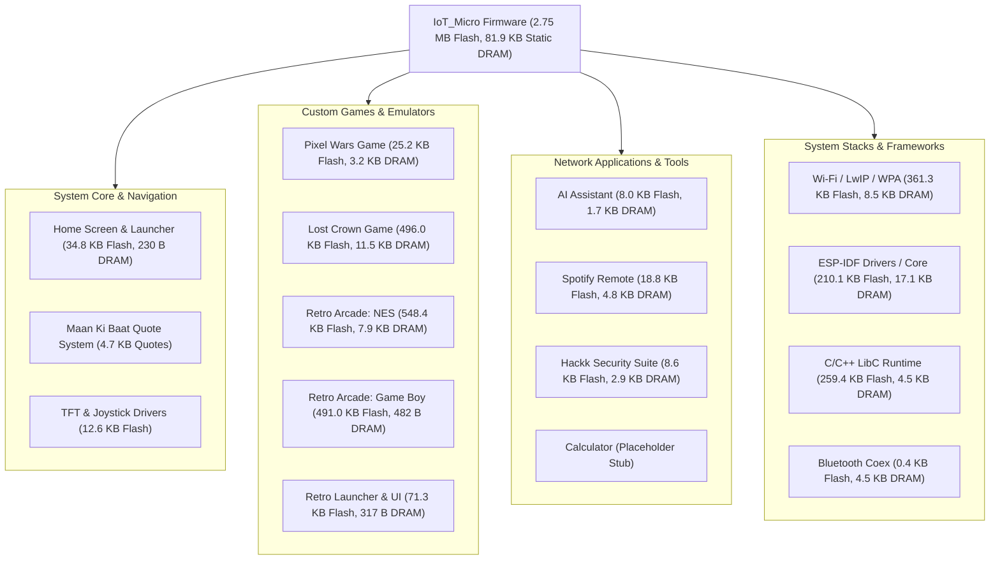

# IoT_Micro — Master Module & Subsystem Memory Breakdown

## 1. Complete Feature & Subsystem Inventory

This audit covers **every single module, application, game, background service, driver, dependency, and embedded asset** discovered across the entire `IoT_Micro` handheld firmware.

---

## 2. Master Module Memory Matrix

| Module / Subsystem | Linked Flash (`.text` + `.rodata`) | Static DRAM (`.data` + `.bss`) | Dynamic Heap (Runtime Peak) | Persistent Inactive? | Optimization Potential |
|---|---:|---:|---:|:---:|---|
| **1. Lost Crown (Action Adventure)** | **496,028 B** | **11,543 B** | **40,960 B** | **YES (DRAM + Flash)** | **EXTREME**: 140 KB duplicate flash assets; 10.7 KB static BSS buffers |
| **2. Retro Arcade — NES Subsystem** | **548,377 B** | **7,905 B** | **~24,576 B** | **YES (DRAM)** | **HIGH**: 532 KB ROMs (Mario 393K, Contra 139K); 4.1 KB PPU display buffer |
| **3. Retro Arcade — Game Boy Subsystem**| **490,964 B** | **482 B** | **~120,000 B** | **NO (Clean)** | **MODERATE**: 456 KB LZ4 ROM data; clean dynamic lifecycle |
| **4. Retro Arcade — Launcher & Assets** | **71,293 B** | **317 B** | **~512 B** | **NO** | **LOW**: 67 KB cover thumbnails (could use JPEG or 4-bit palette) |
| **5. Pixel Wars (Custom Game)** | **25,184 B** | **3,182 B** | **0 B** | **YES (DRAM)** | **MODERATE**: 3.1 KB static entity arrays could be lazy allocated |
| **6. Spotify Remote App** | **18,791 B** | **4,847 B** | **~16,000 B** | **YES (DRAM)** | **HIGH**: 4.6 KB static `artworkBuffer` permanent BSS waste |
| **7. Hackk Security Suite** | **8,615 B** | **2,932 B** | **~2,048 B** | **YES (DRAM)** | **MODERATE**: 2.56 KB static `g_aps` array permanent BSS waste |
| **8. AI Assistant (Gemini Chat)** | **8,003 B** | **1,678 B** | **~8,192 B** | **YES (DRAM)** | **LOW**: 1.6 KB chat history buffer |
| **9. System / OS Core, UI & Quotes** | **34,820 B** | **230 B** | **0 B** | **N/A (Always Active)**| **LOW**: 14 KB icons (2 unused); 4.7 KB quote library |
| **10. Bluetooth Stack (Unused)** | **393 B** | **4,532 B** | **0 B** | **YES (Permanent)** | **HIGH**: 4.5 KB DRAM leaked by unreleased BT controller memory |
| **11. Wi-Fi & Networking Stack** | **361,264 B** | **8,457 B** | **~45,000 B** | Active with Wi-Fi | **MODERATE**: LwIP socket pools and Net80211 station structures |
| **12. ESP-IDF Drivers & Core Dump** | **210,099 B** | **17,122 B** | **~10,000 B** | **YES (Permanent)** | **MODERATE**: 4.9 KB core dump static buffers |
| **13. C/C++ Standard Runtime** | **259,390 B** | **4,477 B** | **~4,096 B** | N/A (Always Active)| **LOW**: LibC `vfprintf`, stdio, math tables |
| **14. Adafruit GFX / ST7735 Driver** | **12,630 B** | **64 B** | **0 B** | N/A (Always Active)| **LOW**: Core display rendering library |
| **15. Calculator App** | **~120 B** | **0 B** | **0 B** | **NO** | Placeholder stub; no memory footprint |
| **Total Linked Firmware** | **2,599,301 B** | **81,896 B** | **~187 KB (Peak)** | — | **~350 KB Flash / ~28 KB DRAM Savings Identified** |

---

## 3. Deep-Dive per Subsystem

### 1. Lost Crown (Action Adventure Game Engine)
- **Source Files**:
  - `src/lost_crown/LostCrownLoading.cpp/.h`
  - `src/lost_crown/LostCrownTitle.cpp/.h`
  - `src/lost_crown/LostCrownGameplay.cpp/.h`
  - `src/lost_crown/Level1.cpp/.h`
  - `src/lost_crown/Level1Assets.h` (1,014,980 bytes)
  - `src/lost_crown/LostCrownAssets.h` (509,164 bytes)
  - `src/lost_crown/LostCrownGameAssets.h` (412,656 bytes)
- **Memory Footprint**:
  - **Flash Code**: 8,566 B
  - **Flash Data (`.rodata`)**: 487,462 B (19.1% of entire firmware!)
  - **Static DRAM**: 11,543 B (14.1% of entire static RAM!)
  - **Dynamic Heap**: 40,960 B in Level 1 (`s_screenBuffer`)
- **Key Allocations & Permanent Waste**:
  - `LostCrownGameplay::stripBuffer`: **5,336 bytes** (Static BSS)
  - `LostCrownGameplay::spriteCompositeBuffer`: **5,336 bytes** (Static BSS)
  - Both buffers remain in DRAM **100% of the time**, even when the user is playing Mario or using AI chat!
- **Asset Duplications**:
  - `LostCrownGameAssets.h` is included in both `Level1.cpp` and `LostCrownGameplay.cpp`, duplicating **~95 KB** of identical sprite arrays in `.rodata`.
  - `LostCrownAssets.h` is included in both `LostCrownLoading.cpp` and `LostCrownTitle.cpp`, duplicating **~40 KB** of background art.

---

### 2. Retro Arcade Subsystems

#### A. NES Emulator Subsystem
- **Source Files**:
  - `src/retro/nes/NesBridge.cpp/.h`
  - `src/retro/nes/NesDisplayAdapter.cpp/.h`
  - `src/retro/nes/NesPalette.cpp/.h`
  - `src/retro/nes/core/cpu6502.cpp/.h`, `ppu2C02.cpp/.h`, `bus.cpp/.h`, `cartridge.cpp/.h`
  - `src/retro/nes/core/mapper000.cpp/.h`, `mapper002.cpp/.h`, `mapper004.cpp/.h`
  - `src/retro/nes/roms/RomMario.S`, `RomContra.S`
- **Memory Footprint**:
  - **Flash Code**: 10,066 B
  - **Flash Data (`.rodata`)**: 538,311 B
    - Super Mario Bros. 3 ROM: **393,232 B**
    - Contra ROM: **139,280 B**
    - Palette LUTs: 5,800 B
  - **Static DRAM**: 7,905 B
    - `Ppu2C02::display_buffer`: **4,096 B** (Static `.data`)
    - `NesDisplayAdapter` scanline LUT: **2,207 B** (Static `.bss`)
    - `NesPalette` RGB565 LUT: **1,025 B** (Static `.bss`)
  - **Dynamic Heap**: 8–32 KB depending on active mapper (PRG RAM / CHR RAM)
- **Lifecycle**: PRG/CHR buffers are allocated on cartridge load and deleted on exit. However, the 4.1 KB `display_buffer` is statically allocated and permanently occupies DRAM.

#### B. Game Boy Emulator Subsystem (Gnuboy Core)
- **Source Files**:
  - `src/retro/gb/GbBridge.cpp/.h`, `GbRom.cpp/.h`, `GbRomBridge.cpp/.h`, `GbSave.cpp/.h`
  - `src/retro/gb/GbDisplayAdapter.cpp/.h`, `GbInput.cpp/.h`
  - `src/retro/gb/core/gnuboy.c`, `hw.c`, `cpu.c`, `lcd.c`, `sound.c`, `mem.c`
  - `src/retro/gb/GbRomData.S`
- **Memory Footprint**:
  - **Flash Code**: 23,955 B
  - **Flash Data (`.rodata`)**: 467,009 B (LZ4 Banks 1–63 = 439,472 B, Bank 0 = 16,384 B, Headers = 11,153 B)
  - **Static DRAM**: 482 B (Exemplary low static footprint!)
  - **Dynamic Heap**: **~120 KB peak**
    - 4-slot 64 KB ROM cache: 65,536 B
    - 4× 8 KB Cartridge SRAM: 32,768 B
    - 8× 4 KB GBC WRAM: 32,768 B
    - 2× 8 KB GBC VRAM: 16,384 B
    - 160×144 8-bit Framebuffer: 23,040 B
    - Burst transfer buffer: 1,024 B
- **Lifecycle**: **100% verified dynamic cleanup**. Every byte allocated on launch is freed on `GbBridge::stop()`, restoring free heap to **161,040 bytes**.

---

### 3. Pixel Wars (Custom Retro Game Engine)
- **Source Files**:
  - `src/pixel_wars/PixelWars.cpp/.h`, `PixelWarsGame.cpp/.h`, `PixelWarsMenu.cpp/.h`
  - `src/pixel_wars/PixelWarsBackground.cpp/.h`, `PixelWarsPlayer.cpp/.h`
  - `src/pixel_wars/PixelWarsEnemies.cpp/.h`, `PixelWarsProjectiles.cpp/.h`
  - `src/pixel_wars/PixelWarsShared.h`
- **Memory Footprint**:
  - **Flash Code**: 20,653 B
  - **Flash Data (`.rodata`)**: 4,531 B
  - **Static DRAM**: 3,182 B (`enemies[16]`, `projectiles[16]`, starfield background coordinates)
  - **Dynamic Heap**: 0 B (All entity pools are statically allocated)
- **Lifecycle**: Zero runtime allocations; predictable execution timing, but the 3.1 KB pool sits idle in DRAM when not playing.

---

### 4. Spotify Remote App
- **Source Files**:
  - `src/spotify/SpotifyApp.cpp/.h`
  - `src/spotify/SpotifyConnection.cpp/.h`
  - `src/spotify/SpotifyUI.cpp/.h`
  - `src/spotify/SpotifyTypes.h`
- **Memory Footprint**:
  - **Flash Code**: 15,220 B
  - **Flash Data (`.rodata`)**: 3,571 B
  - **Static DRAM**: 4,847 B
    - `artworkBuffer`: **4,608 bytes** (`uint16_t artworkBuffer[48 * 48]`)
  - **Dynamic Heap**: ~16 KB when connected (Wi-Fi client, JSON parser, TLS session)
- **Optimization**: `artworkBuffer` (4,608 B) can be converted to dynamic heap on `init()` and freed on `exit()`.

---

### 5. Hackk / Hacking Go (Security Suite)
- **Source Files**:
  - `src/hackk/HackkApp.cpp`
  - `src/hackk/attacks/attack_dos.cpp`, `attack_eviltwin.cpp`, `wifi_controller.cpp`, `management_helper.cpp`
  - `src/hackk/ui/ui_menu.cpp`, `ui_deauth.cpp`, `ui_eviltwin.cpp`, `ui_input.cpp`
- **Memory Footprint**:
  - **Flash Code**: 6,417 B
  - **Flash Data (`.rodata`)**: 2,198 B
  - **Static DRAM**: 2,932 B
    - `g_aps[32]`: **2,560 bytes** (32 AP entries × 80 bytes each)
  - **Dynamic Heap**: ~2 KB when active
- **Lifecycle**: Takes exclusive control of Wi-Fi hardware; disconnects normal STA. When exiting, Wi-Fi reconnects.

---

### 6. AI Assistant App (Gemini Mobile Chat)
- **Source Files**:
  - `src/ai/AIApp.cpp/.h`, `AIConnection.cpp/.h`, `AIKeyboard.cpp/.h`
- **Memory Footprint**:
  - **Flash Code**: 6,718 B
  - **Flash Data (`.rodata`)**: 1,285 B
  - **Static DRAM**: 1,678 B (Chat dialogue lines and keyboard cursor state)
  - **Dynamic Heap**: ~8 KB (HTTPClient buffer during query)
- **Companion**: Communicates with `PhoneAI-bridge/server.py` over local HTTP.

---

### 7. Bluetooth Subsystem (Unused Leak)
- **Source Files**: None in `src/`. Pulled in via `libcoexist.a` and `libbt.a`.
- **Memory Footprint**:
  - **Static DRAM**: **4,532 bytes**
    - `hli_vectors.S.obj`: **4,380 bytes** in `.data`
- **Root Cause**: ESP-IDF reserves high-level interrupt vectors and controller RAM for Bluetooth unless `esp_bt_controller_mem_release(ESP_BT_MODE_BTDM)` is explicitly invoked in `setup()`.
- **Reclaimable Memory**: **~4.5 KB static DRAM + up to ~15 KB heap** can be permanently reclaimed with one line of code!

---

## 4. Standalone & Companion Modules in Repository

The repository contains several companion projects and upstream reference clones that are **not linked into the firmware binary**:

| Directory | Type | Files | Repository Size | Linked in Firmware? | Description |
|---|---|---:|---:|:---:|---|
| `spotify-bridge/` | Node.js / Python Server | 1,665 files | 37.2 MB | **NO** | Companion bridge for Spotify OAuth and Web API |
| `PhoneAI-bridge/` | Python Server | 5 files | 5.6 KB | **NO** | Companion bridge for Gemini AI proxy |
| `Anemoia-ESP32-main/` | Upstream Reference Clone | 130 files | 41.6 MB | **NO** | Standalone NES emulator codebase (upstream reference) |
| `retro-go-gmt024-s3-project/` | Upstream Reference Clone | 849 files | 71.1 MB | **NO** | Standalone retro-go project (Gnuboy core reference) |
| `assets/` | Raw Asset Directory | 52 files | 29.2 MB | **NO** | Source PNG mockups, sprite sheets, reference images |
| `rom/Pokemon Red.gb` | Raw ROM | 1 file | 1.05 MB | **NO** | Raw 1 MB Game Boy ROM (only compressed LZ4 is linked) |

