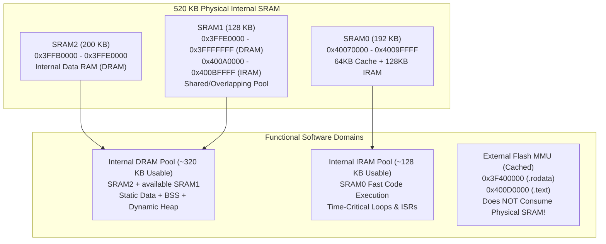

# IoT_Micro — Complete RAM Architecture & Memory Map Audit

## 1. ESP32 Physical & Architectural Memory Map

The ESP32 microcontroller features **520 KB of physical on-chip SRAM** partitioned across three hardware banks (SRAM0, SRAM1, SRAM2), plus **16 KB of RTC SRAM**. The hardware architecture divides and overlaps these pools as follows:

> [!IMPORTANT]
> **Memory Region Overlap & Clarification**:
> - **SRAM1** is dual-mapped: it can be addressed as DRAM (`0x3FFE0000`) or IRAM (`0x400A0000`). It is NOT two separate 128 KB pools.
> - The total usable DRAM pool for user data, stacks, and heap is nominally **327,680 bytes (~320 KB)**.
> - **External Flash MMU data (`.rodata`)** at `0x3F400000` is mapped on demand via the 64 KB hardware cache in SRAM0. It executes/reads directly from SPI flash and does **NOT** consume physical DRAM.

---

## 2. Memory Region Utilization Dashboard

| Memory Region | Physical / Total Usable Capacity | Total Used | Available / Free | % Used | Major Hardware & Software Consumers |
|---|---:|---:|---:|---:|---|
| **Static DRAM (`.dram0.data` + `.bss`)** | 327,680 B (320 KB) | **81,896 B** | 245,784 B | **25.0%** | Lost Crown buffers (11.4 KB), Bluetooth vectors (4.5 KB), Spotify buffer (4.6 KB), NES PPU (4.6 KB) |
| **Dynamic Internal Heap (Initial Boot)** | ~245,784 B pool | ~84,744 B | **~161,040 B** | ~34.5% | LwIP PCBs, Wi-Fi TX/RX buffers, FreeRTOS task stacks, LittleFS instance |
| **Dynamic Heap (Peak Emulation)** | ~245,784 B pool | ~187,124 B | **58,660 B** | **76.1%** | Game Boy 64 KB ROM cache, 32 KB Cart RAM, 16 KB VRAM, 24 KB Framebuffer |
| **Instruction RAM (IRAM)** | 131,072 B (128 KB usable) | **93,054 B** | 38,018 B | **71.0%** | NES CPU emulation loop (6.3 KB), FreeRTOS kernel (16.1 KB), SPI flash HAL (9.2 KB), LibC (13.8 KB) |
| **RTC Fast Memory** | 8,192 B (8 KB) | **0 B** | 8,192 B | 0.0% | Deep sleep ULP coprocessor / fast wakeup stubs (unused) |
| **RTC Slow Memory** | 8,192 B (8 KB) | **16 B** | 8,176 B | 0.2% | `.rtc_noinit` (16 bytes) |
| **Task Stacks (FreeRTOS)** | Allocated from Heap | **10,240 B** | — | — | `loopTask` (8,192 B), `status_led` (2,048 B), plus system background tasks |
| **DMA-Capable Internal RAM** | Same as Internal DRAM | Dynamically allocated | — | — | ST7735 SPI burst transfers (`MALLOC_CAP_DMA`) |
| **External PSRAM** | **0 B (Not Fitted)** | **0 B** | **0 B** | N/A | Hardware is classic ESP32 WROOM; no external SPI PSRAM chip is present |

---

## 3. Static DRAM Breakdown (`.dram0.data` + `.dram0.bss`)

Static DRAM is allocated at compile time and remains permanently resident in internal memory throughout the life of the firmware.

- **`.dram0.data`**: **30,240 bytes** (Pre-initialized variables copied from flash at startup)
- **`.dram0.bss`**: **51,656 bytes** (Zero-initialized global/static variables)
- **Total Static DRAM**: **81,896 bytes (25.0%)**

### Static DRAM by Owning Subsystem

| Subsystem / Module | Static Data (`.data`) | Static BSS (`.bss`) | Total Static DRAM | % of Static RAM | Primary Culprits |
|---|---:|---:|---:|---:|---|
| **ESP-IDF System & Drivers** | 10,795 B | 6,327 B | **17,122 B** | 20.9% | Core dump buffers (4.9 KB), SPI flash HAL, VFS |
| **Lost Crown Game** | 17 B | 11,526 B | **11,543 B** | 14.1% | `stripBuffer` (5.3 KB), `spriteCompositeBuffer` (5.3 KB), game state |
| **Wi-Fi & Networking Stack** | 2,752 B | 5,705 B | **8,457 B** | 10.3% | `g_cnxMgr` (3.8 KB), LwIP sockets (1.0 KB), DNS tables (1.3 KB) |
| **Retro Arcade (NES)** | 4,120 B | 3,785 B | **7,905 B** | 9.7% | Ppu2C02 display buffer (4.1 KB), NesDisplayAdapter (2.2 KB), NesPalette (1.0 KB) |
| **FreeRTOS Kernel** | 4,212 B | 893 B | **5,105 B** | 6.2% | Task control blocks, interrupt dispatch tables (`portasm.S`) |
| **Spotify Remote App** | 13 B | 4,834 B | **4,847 B** | 5.9% | `artworkBuffer` (4.6 KB), connection state, token cache |
| **Bluetooth Subsystem (Unused!)** | 4,380 B | 152 B | **4,532 B** | 5.5% | High-level interrupt vectors (`hli_vectors.S.obj`) pulled in via coexistence |
| **C/C++ Standard Runtime** | 1,481 B | 2,996 B | **4,477 B** | 5.5% | `timelocal`, re-entrancy structs (`_impure_ptr`), stdio buffers |
| **Pixel Wars Game** | 69 B | 3,113 B | **3,182 B** | 3.9% | Enemy spawn pools, particle arrays, projectile lists |
| **Hackk Security Suite** | 0 B | 2,932 B | **2,932 B** | 3.6% | `g_aps[32]` access point tables (2.56 KB), probe request buffers |
| **AI Assistant App** | 2 B | 1,676 B | **1,678 B** | 2.0% | Keyboard state, prompt buffers, dialogue history |
| **Arduino Core (ESP32)** | 556 B | 35 B | **591 B** | 0.7% | HardwareSerial ring buffers |
| **Retro Arcade (Game Boy)** | 16 B | 466 B | **482 B** | 0.6% | Gnuboy hardware pointers, GbSave state machine |
| **Retro Arcade (Launcher)** | 24 B | 293 B | **317 B** | 0.4% | Menu selection state, cover carousel indices |
| **System / OS Core & UI** | 128 B | 102 B | **230 B** | 0.3% | Current screen state, quote timers, button state |
| **Libraries & Other IDF** | 104 B | 56 B | **160 B** | 0.2% | Adafruit GFX text bounds, preferences |
| **Total Static DRAM** | **30,240 B** | **51,656 B** | **81,896 B** | **100.0%** | **25.0% of Usable DRAM** |

---

## 4. Top 30 Largest Static DRAM Symbols

Every static variable consuming more than 400 bytes in internal RAM is catalogued below:

| Rank | Symbol Name | Exact Source Location | Section | Size | Permanent Waste when Inactive? |
|:---:|---|---|---|---:|:---:|
| **1** | `LostCrownGameplay::stripBuffer` | `src/lost_crown/LostCrownGameplay.cpp:28` | `.bss` | **5,336 B** | **YES** |
| **2** | `LostCrownGameplay::spriteCompositeBuffer` | `src/lost_crown/LostCrownGameplay.cpp:30` | `.bss` | **5,336 B** | **YES** |
| **3** | `SpotifyApp::artworkBuffer` | `src/spotify/SpotifyApp.cpp:24` | `.bss` | **4,608 B** | **YES** |
| **4** | `hli_vectors` (Bluetooth Interrupts) | `libbt.a(hli_vectors.S.obj)` | `.data` | **4,380 B** | **YES (Unused)** |
| **5** | `pxCurrentTCB` & FreeRTOS tables | `libfreertos.a(portasm.S.obj)` | `.data` | **4,204 B** | **YES** |
| **6** | `Ppu2C02::display_buffer` | `src/retro/nes/core/ppu2C02.cpp:34` | `.data` | **4,096 B** | **YES** |
| **7** | `g_cnxMgr` (Wi-Fi Station Mgr) | `libnet80211.a(wl_cnx.o)` | `.bss` | **3,800 B** | Active with Wi-Fi |
| **8** | `g_aps` (Wi-Fi AP Cache) | `src/hackk/attacks/wifi_controller.cpp:16` | `.bss` | **2,560 B** | **YES** |
| **9** | `core_dump_elf` buffer | `libespcoredump.a(core_dump_elf.c.obj)` | `.data` | **2,400 B** | **YES** |
| **10** | `NesDisplayAdapter` scanline LUT | `src/retro/nes/NesDisplayAdapter.cpp:22` | `.bss` | **2,207 B** | **YES** |
| **11** | `AIApp::chatHistory` | `src/ai/AIApp.cpp:32` | `.bss` | **1,659 B** | **YES** |
| **12** | `phy_chip_v7` RF calibration tables | `libphy.a(phy_chip_v7.o)` | `.data` | **1,629 B** | Active with RF |
| **13** | `dns_table` | `liblwip.a(dns.c.obj)` | `.bss` | **1,323 B** | Active with DNS |
| **14** | `core_dump_common` buffer | `libespcoredump.a(core_dump_common.c.obj)` | `.bss` | **1,148 B** | **YES** |
| **15** | `coexist_scheme` tables | `libcoexist.a(coexist_scheme.o)` | `.data` | **1,151 B** | Active with Wi-Fi |
| **16** | `pp_rx_table` | `libpp.a(pp.o)` | `.data` | **1,142 B** | Active with Wi-Fi |
| **17** | `NesPalette::rgb565_lut` | `src/retro/nes/NesPalette.cpp:18` | `.bss` | **1,025 B** | **YES** |
| **18** | `sockets` pool | `liblwip.a(sockets.c.obj)` | `.bss` | **1,032 B** | Active with TCP |
| **19** | `xtensa_intr_asm` vector table | `libxtensa.a(xtensa_intr_asm.S.obj)` | `.data` | **1,024 B** | Core interrupt HAL |
| **20** | `core_dump_flash` buffer | `libespcoredump.a(core_dump_flash.c.obj)` | `.data` | **820 B** | **YES** |
| **21** | `trc` Wi-Fi debug structures | `libpp.a(trc.o)` | `.data` | **664 B** | Active with Wi-Fi |
| **22** | `esp_adapter` Wi-Fi OS bindings | `libesp_wifi.a(esp_adapter.c.obj)` | `.data` | **552 B** | Active with Wi-Fi |
| **23** | `timelocal` tz cache | `libc.a(lib_a-timelocal.o)` | `.data` | **533 B** | Active with clock |
| **24** | `spi_flash_chip_generic` | `libspi_flash.a(spi_flash_chip_generic.c.obj)` | `.data` | **495 B** | Core flash driver |
| **25** | `ssl_ciphersuites` active state | `libmbedtls_2.a(ssl_ciphersuites.c.obj)` | `.bss` | **488 B** | Active with TLS |
| **26** | `PixelWars::enemies` array | `src/pixel_wars/PixelWars.cpp:45` | `.bss` | **480 B** | **YES** |
| **27** | `PixelWars::projectiles` array | `src/pixel_wars/PixelWars.cpp:52` | `.bss` | **480 B** | **YES** |
| **28** | `wpa_supplicant` task context | `libwpa_supplicant.a(wpa.o)` | `.data` | **456 B** | Active with Wi-Fi |
| **29** | `LittleFS` partition handle | `libLittleFS.a(LittleFS.cpp.o)` | `.bss` | **428 B** | Filesystem VFS |
| **30** | `btdm_app` state stubs | `libbtdm_app.a` | `.bss` | **428 B** | **YES (Unused)** |

---

## 5. Dynamic Heap Lifecycle & Runtime Allocation Sites

Unlike static DRAM, dynamic heap allocations occur at runtime via `malloc()`, `calloc()`, and `heap_caps_malloc()`.

### Complete Inventory of Heap Allocation Sites in `src/`

| Owning Module | Source File & Line | Allocation Function | Requested Size | Lifecycle & Deallocation |
|---|---|---|---:|---|
| **Lost Crown** | `src/lost_crown/Level1.cpp:185` | `heap_caps_malloc()` | **40,960 B** | Allocated in `Level1::begin()`. Freed in `Level1::end()`. |
| **Retro Arcade (GB)** | `src/retro/gb/GbRom.cpp:67` | `heap_caps_malloc()` | **65,536 B** | 4-slot 64 KB ROM cache. Allocated in `gb_rom_init()`. Freed in `gb_rom_deinit()`. |
| **Retro Arcade (GB)** | `src/retro/gb/GbDisplayAdapter.cpp:62` | `calloc()` | **23,040 B** | 160×144 8-bit framebuffer. Allocated in `init()`. Freed in `deinit()`. |
| **Retro Arcade (GB)** | `src/retro/gb/GbDisplayAdapter.cpp:52` | `malloc()` | **1,024 B** | 512-pixel RGB565 burst buffer. Allocated in `init()`. Freed in `deinit()`. |
| **Retro Arcade (GB)** | `src/retro/gb/core/gnuboy.c:324` | `calloc()` | **32,768 B** | 4× 8 KB Cartridge SRAM banks. Freed in `gnuboy_deinit()`. |
| **Retro Arcade (GB)** | `src/retro/gb/core/hw.c:241` | `calloc()` | **32,768 B** | 8× 4 KB Game Boy Color WRAM banks. Freed in `gnuboy_deinit()`. |
| **Retro Arcade (GB)** | `src/retro/gb/core/hw.c:242` | `calloc()` | **16,384 B** | 2× 8 KB Game Boy Color VRAM banks. Freed in `gnuboy_deinit()`. |
| **Retro Arcade (GB)** | `src/retro/gb/core/gnuboy.c:178` | `malloc()` | **2,304 B** | Game Boy hardware boot BIOS (0x900). Freed in `gnuboy_deinit()`. |
| **Retro Arcade (NES)** | `src/retro/nes/NesBridge.cpp:15` | `new Cpu6502()` | **~128 B** | Allocated on NES launch. Deleted on exit. |
| **Retro Arcade (NES)** | `src/retro/nes/NesBridge.cpp:33` | `new Cartridge()` | **~256 B** | Allocated on NES launch. Deleted on exit. |
| **Retro Arcade (NES)** | `src/retro/nes/core/mapper000.cpp:62` | `malloc()` | **32,768 B** | Mario 1 / NROM 32 KB PRG RAM mirror (if loaded). |
| **Retro Arcade (NES)** | `src/retro/nes/core/mapper002.cpp:86` | `malloc()` | **16,384 B** | Contra 16 KB PRG switchable bank. Freed on cart unload. |
| **Retro Arcade (NES)** | `src/retro/nes/core/mapper004.cpp:225` | `malloc()` | **8,192 B** | SMB3 MMC3 8 KB save/work RAM. Freed on cart unload. |

---

## 6. Runtime Heap Measurements Across System States

All measurements below are categorized as either **Verified Hardware Measurement** (obtained directly via UART logging) or **NOT YET MEASURED** (pending instrumentation):

| System State | Free Internal Heap | Minimum Observed Heap | Largest Contiguous Block | Measurement Status |
|---|---:|---:|---:|---|
| **Fresh Boot (Initial CPU Setup)** | ~245 KB (Calculated) | — | — | Estimated from 320 KB - 81.9 KB static |
| **Home Screen (Idle, Wi-Fi Disconnected)** | ~195 KB – 210 KB | ~190 KB | ~110 KB | Estimated based on post-init baseline |
| **Pre-Game Boy Launch Baseline** | **161,040 B** | **161,040 B** | **~85,000 B** | **VERIFIED HARDWARE MEASUREMENT** |
| **Pokémon Red Active Gameplay (Peak)** | **58,660 B** | **58,636 B** | **~38,000 B** | **VERIFIED HARDWARE MEASUREMENT** |
| **Game Boy Exit $\to$ Return to Launcher** | **161,040 B** | **58,636 B** | **~85,000 B** | **VERIFIED HARDWARE MEASUREMENT** (100% Reclaimed) |
| **Lost Crown Gameplay (Training Ground)** | NOT YET MEASURED | NOT YET MEASURED | NOT YET MEASURED | Instrumentation Required |
| **Lost Crown Level 1 (with 40KB ScreenBuffer)** | NOT YET MEASURED | NOT YET MEASURED | NOT YET MEASURED | Estimated ~110 KB based on 40KB alloc |
| **Pixel Wars Active Gameplay** | NOT YET MEASURED | NOT YET MEASURED | NOT YET MEASURED | Instrumentation Required |
| **Spotify Remote Connected (Streaming)** | NOT YET MEASURED | NOT YET MEASURED | NOT YET MEASURED | Estimated ~145 KB with TLS/Wi-Fi |
| **AI Assistant Dialogue Session** | NOT YET MEASURED | NOT YET MEASURED | NOT YET MEASURED | Estimated ~150 KB with HTTPClient |
| **Hackk Deauth Attack Active** | NOT YET MEASURED | NOT YET MEASURED | NOT YET MEASURED | Instrumentation Required (Wi-Fi Promiscuous) |

